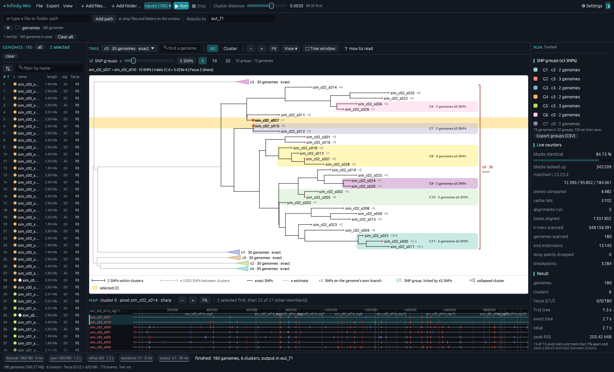
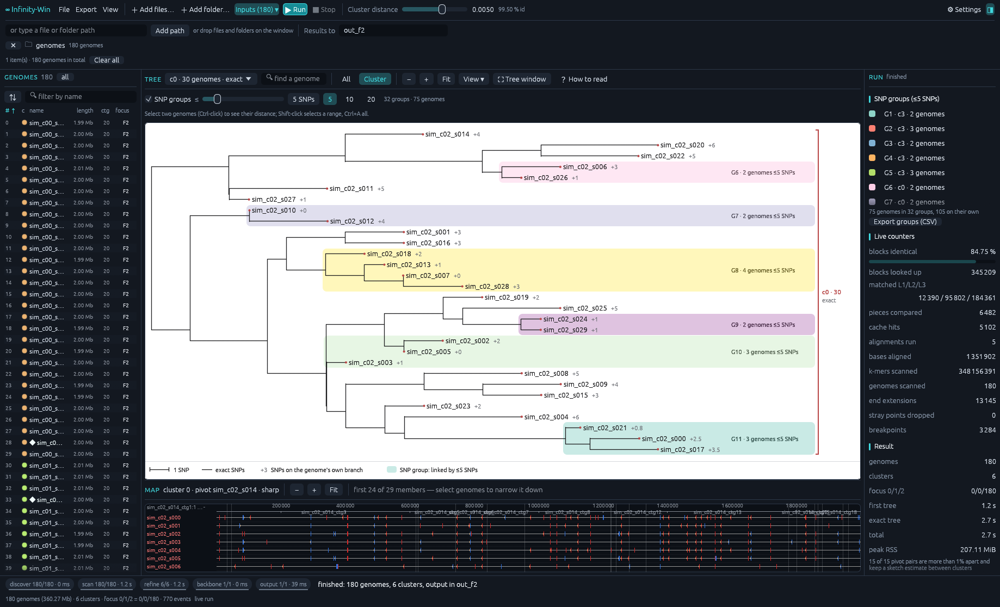
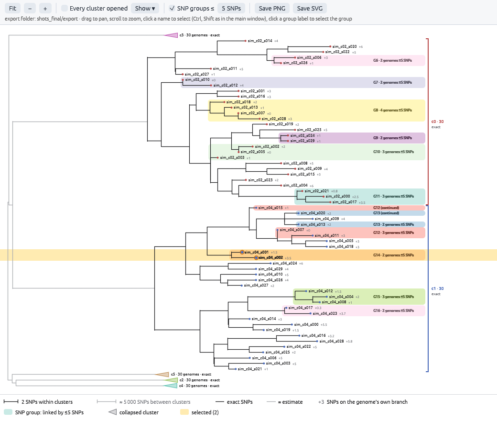
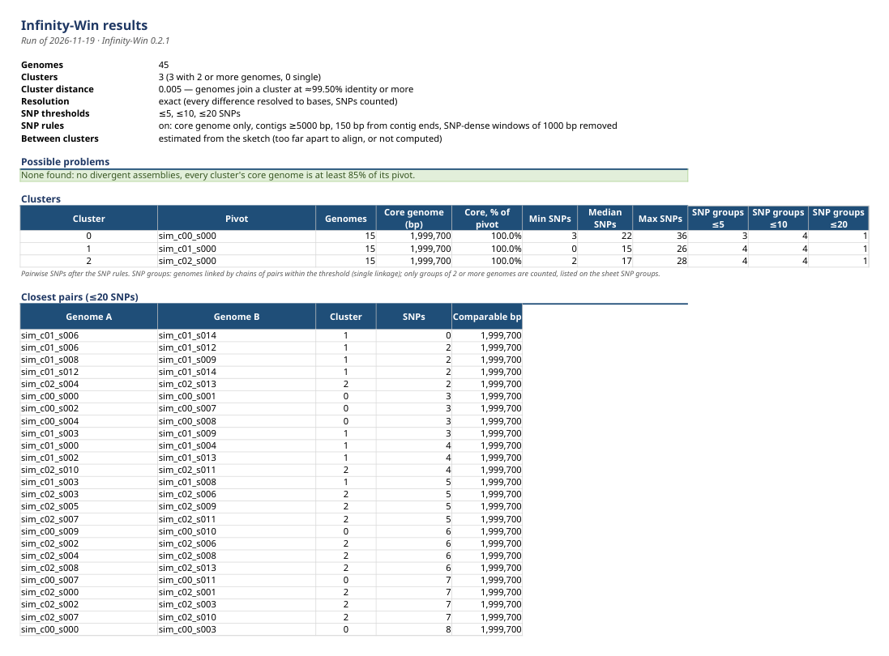
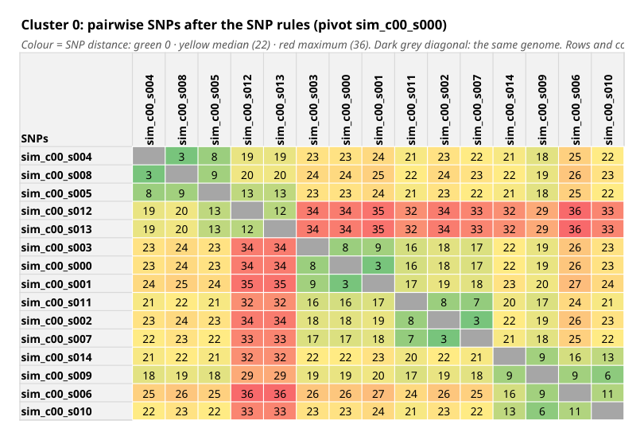
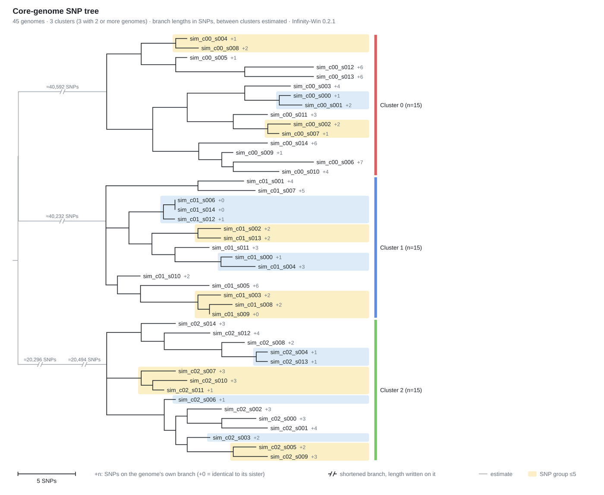

# Infinity-Win

**Compare hundreds of nearly identical bacterial genomes down to single SNPs, in
seconds to minutes, and watch the tree sharpen while it works.**

### [⬇ Download for Windows (portable zip)](https://github.com/iowa69/Infinity-Win/releases/latest/download/Infinity-Win-windows-x64.zip) · [Linux](https://github.com/iowa69/Infinity-Win/releases/latest/download/Infinity-Win-linux-x64.zip)

Nothing to install: unzip and double-click `Infinity-Win.exe`.



*After a run: one cluster opened into its exact SNP tree, the five others
collapsed. After every name, the SNPs on that genome's own branch (`+3`); shaded
bands are SNP groups (genomes linked by at most 5 SNPs, set with the slider above
the tree); the scale bar and legend sit under the tree.*

## What it does

- **Groups your genomes into clusters** of close relatives, from a quick sketch
  of each genome (seconds).
- **Compares the genomes inside each cluster base by base** and counts the SNPs
  between every pair, ignoring the kinds of differences that are usually
  assembly artefacts (repeats, contig ends, recombination).
- **Shows a tree that starts blurry and becomes exact** while it runs, and
  writes an Excel workbook, SNP matrices, trees, a VCF and pictures.

Input: assembled genomes (`.fasta`, `.fa`, `.fna`, optionally `.gz`), one file
per genome, contigs are fine.

## Start in three steps

1. Unzip the download anywhere and double-click **Infinity-Win.exe**. (Windows
   may warn that the program is not signed: *More info → Run anyway*.)
2. Click **＋ Add files…** or **＋ Add folder…** (or drag files and folders onto
   the window). The list under **Inputs** shows how many genomes each holds.
3. Click **Run**.

Clusters appear within seconds as collapsed wedges and turn into exact SNP
trees one by one. Click a cluster to open it, select two genomes to see their
SNP distance, and use the **Run** panel on the right to export.

## Reading the tree

- **Branch length = SNPs.** Dark branches are exact SNP counts inside a
  cluster; grey branches are estimates (between clusters, or a cluster still
  being refined, marked `≈`).
- **The number after a name** (`isolate_12  +3`) is the number of SNPs on that
  genome's own branch: differences its closest relatives do not share. `+0`
  means none of its own.
- **SNP groups.** The slider above the tree (0–100 SNPs, with 5 / 10 / 20 one
  click away) shades the genomes linked by chains of at most that many SNPs,
  as `G3 · 4 genomes ≤5 SNPs`. The groups follow the slider live, are listed in
  the Run panel (click one to select its genomes) and export as CSV.
- **How to read** in the tree header explains all of this in the program.



*One cluster on its own (**Cluster**), SNP groups at 5 SNPs.*

**⛶ Tree window** opens the whole tree as a figure on white, to save as PNG or
SVG:



## The one setting that matters: cluster distance

**What it does.** Infinity-Win only compares genomes base by base when they are
in the same cluster. The cluster distance decides how similar two genomes must
be to share a cluster:

- Genomes **in the same cluster** get **exact SNP distances** to each other.
- Genomes **in different clusters** only get an estimate (exact SNPs between
  clusters only when their representative genomes are within 1%).

So the cluster distance must be **wide enough** to put every pair you care
about in the same cluster, and **narrow enough** that one cluster does not mix
distant lineages.

| if the cluster distance is | what happens |
|---|---|
| **too small** | close genomes end up in different clusters, so you get no exact SNP distance between them; many single-genome clusters |
| **too large** | different lineages share a cluster: the run is slower, and the core genome (the part every member shares, where SNPs are counted) shrinks, so fewer SNPs are counted |

**What the numbers mean.** The distance is roughly the fraction of bases that
differ (1 − identity):

| cluster distance | identity | ≈ SNPs apart, 2.8 Mb genome (*S. aureus*) | ≈ SNPs apart, 5 Mb genome (*E. coli*, *Salmonella*) |
|---|---|---|---|
| 0.001 | 99.9% | 2,800 | 5,000 |
| 0.003 | 99.7% | 8,400 | 15,000 |
| **0.005 (default)** | **99.5%** | **14,000** | **25,000** |
| 0.01 | 99.0% | 28,000 | 50,000 |

Outbreak and transmission thresholds are usually 5–50 SNPs, far below all of
these, so even 0.001 keeps a transmission pair together. The question is how
much **context** you want in each cluster: the default 0.005 groups roughly a
sequence type or clonal complex.

**How to choose for your data.** Let the data decide, in seconds:

```
infinity thresholds <your genome folder>
```

It sketches the genomes and shows, for each candidate distance, how many
clusters you would get and how many genome pairs sit right at the cut. A
distance with few pairs near the cut lies in a natural gap of your data, so the
clusters will not change with small differences. On the 137-genome *S. aureus*
bloodstream cohort of the validation it printed:

```
 distance   identity  ~SNPs apart  clusters  singletons  largest  near the cut
    0.001     99.90%         2743        46          25       15          418
    0.003     99.70%         8228        24          11       19           73
    0.005     99.50%        13714        24          11       19          948
     0.01     99.00%        27428        10           4       68         3706
Suggested cluster distance: 0.003 (99.70% identity, 24 clusters).
```

**Rules of thumb**

- **Outbreak, transmission, within-host:** keep the default 0.005, or use the
  suggestion from `infinity thresholds`.
- **Population structure of one species:** 0.003–0.005 gives roughly one cluster
  per lineage.
- **Never above 0.01** (99% identity): the comparison becomes slower and less
  exact. **Never below 0.001**: the sketch cannot measure such small distances
  reliably.
- **Check the result:** in the Excel *Clusters* sheet (or `clusters.tsv`), the
  *core genome* of each cluster should be at least about 85% of the genome
  length. If it is smaller, that cluster is too diverse: lower the distance.

Set it in **Settings → Resolution → Cluster distance** (shown with its %
identity) before clicking Run, or with `--cluster-dist` on the command line.

## Other settings, briefly

- **How far to refine:** *Sketch* (clusters only, seconds), *Blocks* (where
  genomes differ), *Exact SNPs* (default).
- **SNP thresholds** (default 5, 10, 20): genomes linked by chains of at most
  that many SNPs are grouped into SNP clusters, reported per genome in the
  Excel workbook and `snp_clusters.tsv`.
- **SNP rules** (on by default): only differences in the core genome that are
  not near contig ends, not on short or high-copy contigs, and not in
  recombination-like clusters count. Turning them off counts every difference;
  every file keeps both numbers anyway.

## What you get

| file | what it is |
|---|---|
| `results.xlsx` | Excel workbook: a **Summary** sheet (clusters, closest pairs, possible problems), SNP groups, one **colour-scaled SNP matrix** per cluster ordered like the tree, genomes, variants, settings |
| `cluster_<id>.snp_matrix.tsv` | square SNP distance matrix of one cluster |
| `tree.nwk`, `tree.svg` | the full tree with branch lengths in SNPs, as Newick and as a publication-style picture (SNPs at the tips, SNP groups shaded) |
| `snp_clusters.tsv` | each genome's SNP cluster at every SNP threshold |
| `cluster_<id>.vcf`, `cluster_<id>.core_snps.fasta` | SNPs as VCF, and the core SNP alignment for IQ-TREE or Gubbins |

The desktop program also exports NEXUS (FigTree), iTOL datasets, SVG and PNG.

**The Excel workbook** opens on a Summary sheet: the settings in plain words, a
"possible problems" box (divergent assemblies, clusters too diverse), one row
per cluster, and the closest pairs.



Every cluster gets a SNP matrix coloured from green (identical) through yellow
(the cluster's median) to red (its maximum), with rows and columns in tree order
so that related genomes form blocks.



**The tree picture** (`tree.svg`) is ready for a report or a paper: SNPs on each
genome's own branch, SNP groups shaded, clusters marked on the right, and very
long branches between clusters shortened (`//`) with their real length written
on them.



## How accurate is it

Compared with SKA2 run on the sequencing reads:

| data | result |
|---|---|
| *Salmonella* outbreak trio | exactly the published 2 / 0 / 2 SNPs |
| 32-genome *Salmonella* outbreak cluster | 494 of 496 pairs within 5 SNPs, correlation 0.977, 1.8 s |
| 137-genome *S. aureus* cohort | transmission pairs at 8, 8, 14, 15 SNPs; first tree in 0.6 s, all exact in 28 s |

Details: [docs/VALIDATION.md](docs/VALIDATION.md). Known limit: SNPs inside
repeats that the assembler collapsed into one copy cannot be recognised from
assemblies alone, and can add a few SNPs to a pair.

## Command line

```
infinity thresholds genomes/                      # suggest a cluster distance
infinity run genomes/ -o results/                 # compare, write everything
infinity run genomes/ -o results/ --cluster-dist 0.003 --snp-thresholds 5,20
Infinity-Win --open results/                      # explore a finished run
```

## Author

Infinity-Win is written and maintained by [iowa69](https://github.com/iowa69). MIT licence.

## More

- [docs/USER_GUIDE.md](docs/USER_GUIDE.md): every option, file and column
- [docs/VALIDATION.md](docs/VALIDATION.md): how it was tested on real data
- [PROJECT.md](PROJECT.md), [DECISIONS.md](DECISIONS.md): design and decisions
