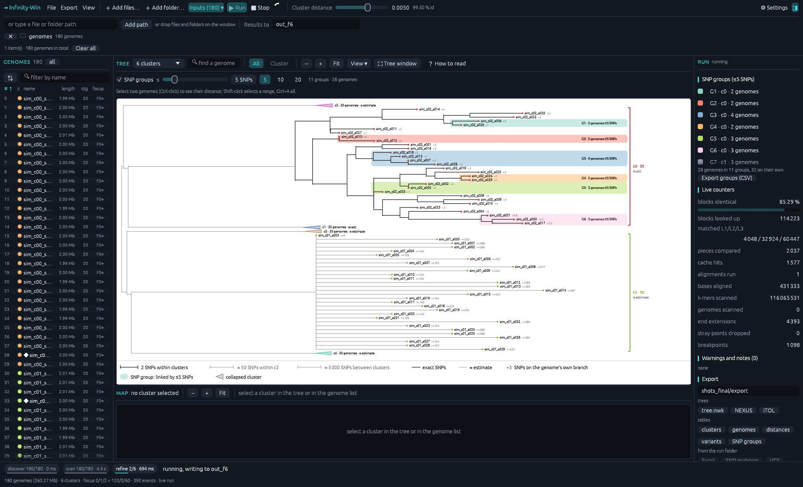
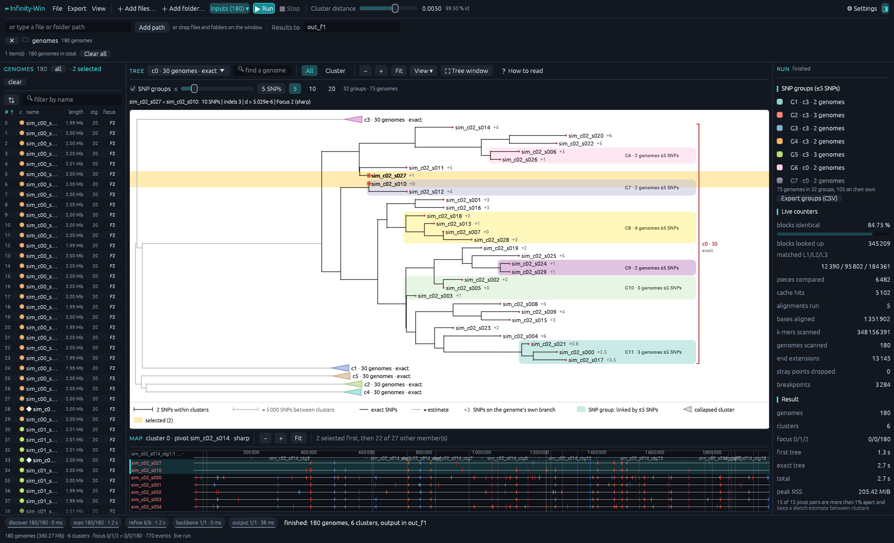
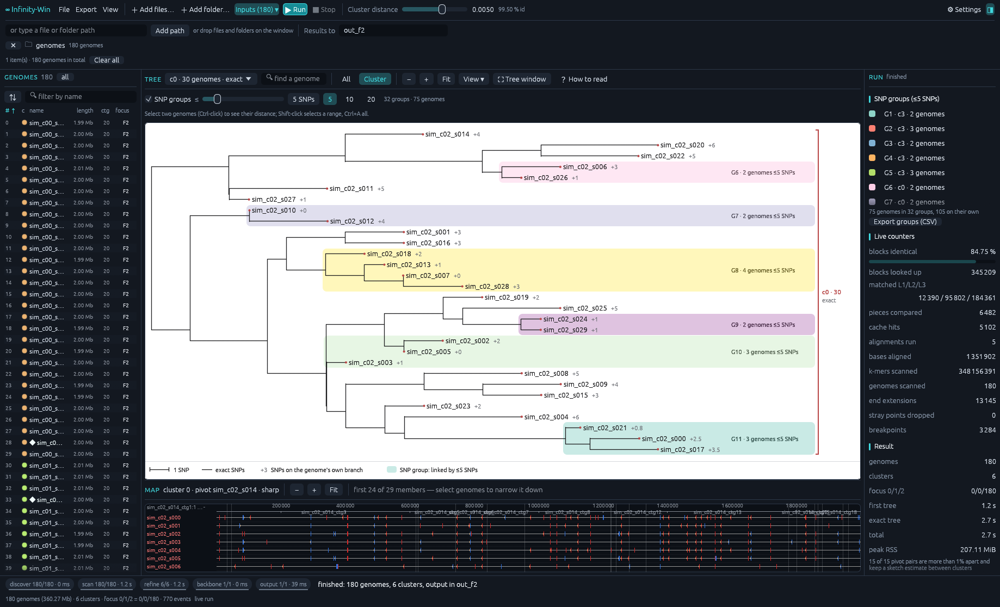
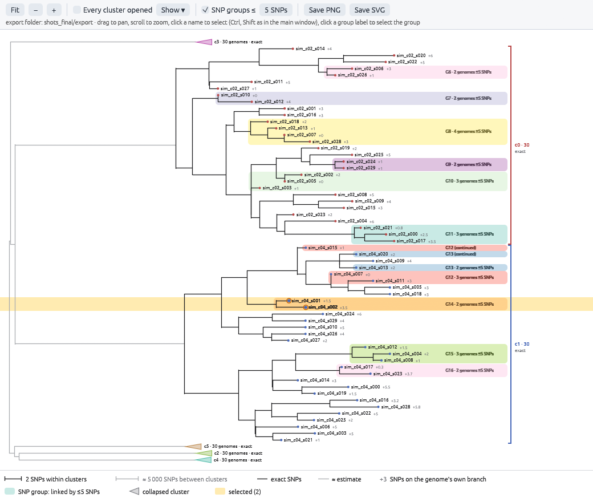
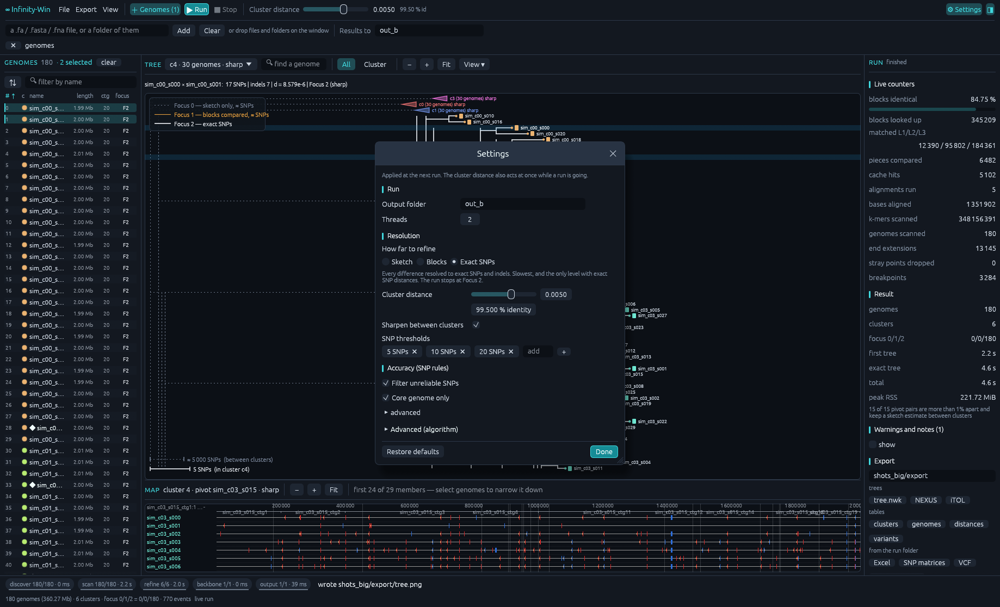

# Infinity-Win user guide (full reference)

The short introduction is the [README](../README.md). This page documents every option and file.

**Progressive, cluster-first, position-aware comparison of nearly identical
genomes, with a live tree that sharpens while the computation runs.**

Infinity-Win takes a set of assembled genomes and answers, in that order and as fast as
it can: *which genomes are near each other* → *where do they differ* → *what
exactly differs, base by base*. Every number it shows carries a **focus level**,
so you always know whether you are looking at a sketch estimate or an exact count.

```
Focus 0   sketch only          seconds    "these 41 genomes form a cluster"
Focus 1   blocks compared      ~10x more  "this member differs in 8 places"
Focus 2   exact, base level     minutes    "2 SNPs, at these positions, these bases"
```

It is designed for bacterial assemblies of 0.5–15 Mb, from tens up to a few
thousand genomes, that are **already close** — outbreak investigation,
transmission clustering, within-host evolution. It is not a phylogenetics package
and it is not a read mapper.

Infinity-Win was developed under the working name **M-Tato**; older commits and
`DECISIONS.md` entries use that name.

## What's new in 0.2

- **SNP rules that make the counts match read-based pipelines.** Every
  difference is still reported, but only differences in the **core genome**
  that pass the rules count towards distances and trees. Rejected calls are
  *masked*, so they leave the denominator too:

  | rule | what it removes |
  |---|---|
  | core genome | bases that any genome of the cluster does not cover |
  | short contigs | pivot contigs under 5 kb (collapsed repeats, plasmid fragments) |
  | contig ends | 150 bp at each end of every pivot contig |
  | high-copy contigs | pivot contigs with more than 1.8x the typical coverage (when the assembler wrote coverage into the contig names) |
  | engine flags | calls the engine itself marked uncertain (`repeat`, `end_ext`, ...) |
  | SNP clusters | more SNPs in a 1 kb or 100 bp window than a Poisson process allows (recombination, misassembly) |
  | four-gamete test | sites whose alleles form all four combinations with two or more neighbours: they cannot be single clonal mutations (recombination, collapsed repeats) |

  Every file keeps both: `snps` (after the rules) and `raw_snps` (everything).
  Each variant row says `PASS` or why it does not count.
- **A contig-end bug fixed.** Extension at contig ends started from the wrong
  end of a matched block, leaving about 800 bp per contig uncompared on
  fragmented assemblies and occasionally inventing SNPs. Now about 70 bp.
- **Resolution setting.** `--resolution sketch | blocks | exact` decides how far
  iterative refinement goes, and `--snp-thresholds 5,10,20` groups genomes into
  SNP clusters (single linkage) at each cut-off.
- **Trees in SNPs.** `tree.nwk` now has branch lengths in SNPs. Clusters whose
  pivots are within 1% of each other are compared exactly, so the branches
  between them are SNP counts too.
- **New result files:** `results.xlsx` (Excel workbook), square SNP matrices,
  `snp_clusters.tsv`, a VCF and a core-SNP alignment per cluster, `tree.svg`.
- **Desktop program:** panels no longer overlap on laptop screens, the tree is
  drawn in SNPs with a scale bar, a Settings window groups the parameters, and
  the look was reworked.
- **Portable Windows build:** a zip with `Infinity-Win.exe` and `infinity.exe`
  that needs nothing installed.

## Validation on real data

Details and commands are in [`VALIDATION.md`](VALIDATION.md). In short, against SKA2 run on
the **reads** (the closest available truth):

| dataset | genomes | result |
|---|---|---|
| *Salmonella* Heidelberg outbreak trio | 3 | exactly 2 / 0 / 2 SNPs, as published (0.1: 17 / 4 / 2) |
| *Salmonella* NCBI Pathogen Detection cluster | 32 | 494 of 496 pairs within 5 SNPs, worst 6, correlation 0.977 (0.1: 0.41) in 1.8 s |
| *S. aureus* bloodstream cohort, the 4 transmission pairs | 137 | Infinity-Win 8, 8, 14, 15 SNPs; SKA2 on reads 6, 8, 8, 15; checked base by base in the raw reads: 8, (not checked), 8 + 2 unclear, 14. All 137 genomes in 28 s |
| real *S. aureus* genomes, simulated descendants cut into 60 contigs, known truth | 150 | no pair over-reported; 93% of true SNPs inside the core |

Where Infinity-Win still over-counts, the reads show collapsed repeats: both
alleles present in each isolate, which an assembly cannot reveal. For pairs
hundreds of SNPs apart, the rules remove recombination-dense windows, so counts
are lower than SKA2's; use `raw_snps` there.

## Screenshots

**During a run.** 180 simulated genomes in 6 clusters. Two clusters are already
exact; the others still show their sketch estimate (grey branches, numbers with
`≈`). Distances are drawn in SNPs, with an approximate scale between clusters.



**Finished.** One cluster opened into its exact SNP tree, the others collapsed
into wedges. After every name, the SNPs on that genome's own branch (`+3`); the
shaded bands are SNP groups at 5 SNPs; two genomes are selected (their distance
is shown above the tree), and the map below shows them against the cluster's
pivot: red ticks are SNPs, blue ticks insertions and deletions. The Run panel on
the right lists the SNP groups and exports trees (Newick, NEXUS for FigTree,
iTOL), tables, the SNP groups, the Excel workbook, SNP matrices, the VCF, the
SNP alignment and pictures (SVG, PNG).



**SNP groups.** One cluster on its own (the **Cluster** button), with the slider
at 5 SNPs: every shaded band is a group of genomes linked by chains of at most 5
SNPs.



**The tree window.** The whole tree as a figure on white, with the same SNP
numbers, groups, scale bar and legend; save it as PNG or SVG.



**Settings.** How far to refine (Sketch, Blocks or Exact SNPs), the cluster
distance as % identity, whether to sharpen the distances between clusters, the
SNP thresholds for SNP clusters, and the SNP rules.



## Install

### From source (Linux and Windows)

You need a stable Rust toolchain. There is no C toolchain requirement, no
Python runtime, and no external bioinformatics tool to install: the aligner, the
neighbour-joining tree code, the Newick reader/writer and the Robinson–Foulds
distance are all implemented in the project.

```sh
curl --proto '=https' --tlsv1.2 -sSf https://sh.rustup.rs | sh
git clone <this repository> && cd Infinity-Win
cargo build --release
```

Two binaries land in `target/release/`:

| Binary | What it is |
|---|---|
| `infinity` | the command-line tool: `run`, `simulate`, `bench` |
| `Infinity-Win` | the desktop program |

On Windows the same commands work in PowerShell or `cmd`. Prebuilt binaries for
Windows x86-64 and Linux x86-64 are produced by `.github/workflows/release.yml`
and attached to the release; see `DECISIONS.md` D4 for why cross-compiling from
Linux is not part of the local build.

---

## Quick start

Point it at a folder of assemblies. One file is one genome; `.fa`, `.fasta` and
`.fna`, plain or gzipped, are accepted.

```sh
infinity run ./assemblies -o ./results
```

```
[    0.00s] discover  312/312
[    2.14s] scan      312/312
[    2.31s] clustered 312 genomes into 12 clusters at d<=0.005 (largest 88)
[    2.34s] backbone tree ready over 12 clusters  <-- first blurry tree
[   41.87s] refine    12/12
genomes 312 | clusters 12 | focus 0/1/2 = 0/0/312 | first tree 2.34s | exact 41.90s
output written to ./results
```

Then look at the results:

```sh
column -t -s$'\t' results/clusters.tsv      # which genomes cluster together
less results/cluster_3.variants.tsv         # every difference, with positions
cat results/tree.nwk                        # the full tree
```

Or open the folder in the GUI, which reads a finished run without recomputing it:

```sh
Infinity-Win
```

### A worked example with known truth

The simulator produces genomes together with the answer, which is the fastest way
to see whether the tool is behaving:

```sh
infinity simulate -o /tmp/sim --seed 42 --length 2000000 -m 1 -n 50 --mean-snps 3
infinity run /tmp/sim/genomes -o /tmp/out
infinity bench --output /tmp/out --truth /tmp/sim/truth
```

```
  distances:
    pairs in truth 1225 | compared 1225 | missing 0
    exact 1225 | max |error| 0 | mean |error| 0.000
    fraction exact 1.0000 | sum reported / sum true 1.0000
  clusters:
    true 1 | reported 1 | recovered exactly 1 | pairwise F1 1.0000
  trees:
    cluster_0  vs tree_c00  leaves 50  RF 0  normalised 0.0000
```

---

## `infinity run`

```
infinity run <files or folders...> -o <outdir> [options]
```

### Parameters (defaults from section 6.1 of the design outline)

| Flag | Default | Meaning |
|---|---|---|
| `--k` | 31 | Anchor k-mer length. Must be odd, at most 31. |
| `--densities` | `16384,2048,256` | One anchor per this many k-mers at levels 1, 2, 3. Each must divide the previous. |
| `--sketch-level` | 2 | Level whose anchors form the sketch used for clustering. |
| `--cluster-dist` | 0.005 | Sketch distance threshold for joining a cluster (≈99.5% identity). |
| `--max-span-ratio` | 10 | Collinearity limit on span ratio. |
| `--max-span-extra` | 50000 | Collinearity limit slack, in bases. |
| `--dp-max-len` | 5000 | Longest trimmed piece aligned by dynamic programming. |
| `--min-identity` | 0.70 | Below this, a piece is reported as one `complex` variant. |
| `--xdrop` | 15 | Stop rule for ungapped extension at contig ends. |
| `--threads` | all cores | Worker threads. `0` means all. |
| `--memory-budget` | ¼ of RAM | Bytes of non-pivot sequence kept before re-reading from disk. |

If the median genome is under 500 kb the densities are automatically switched to
`1024,128,16` and a warning is logged — at 256-base spacing a small genome would
produce too few anchors to map.

### Experiment switches

Each of these removes one part of the idea so that its cost can be measured. They
exist for the benchmark in section 11 and are not normally used.

| Flag | Removes |
|---|---|
| `--flat` | The nested levels; only leaf blocks are used. |
| `--no-block-skip` | Block hashing entirely; every stretch between shared anchors is compared directly. |
| `--no-piece-cache` | Resolving a shared difference once. |
| `--no-profile-grouping` | Handling identical genomes once. |
| `--single-cluster` | Cluster-first; every genome is compared to one pivot. |
| `--focus0-only` | Refinement; stop at the blurry tree. |

`--flat`, `--no-piece-cache` and `--no-profile-grouping` leave the variants,
distances and trees unchanged, which is asserted by a test. `--no-block-skip`
does not: see `DECISIONS.md` D16.

### Output folder

| File | Content |
|---|---|
| `genomes.tsv` | One row per genome: length, contigs, N50, GC, cluster, is_pivot, focus, SNPs vs pivot (all), indels vs pivot, uncovered bp, novel bp, passing SNPs vs pivot. |
| `clusters.tsv` | Cluster id, pivot, pivot name, size, focus, core genome bp. |
| `tree.nwk` | The full tree, branch lengths in **SNPs**. Between clusters these are exact for pivots within 1% of each other and sketch estimates beyond. |
| `tree.subs_per_site.nwk` | The same tree in substitutions per site. |
| `tree.svg` | A print-ready picture of the full tree: each name is followed by the SNPs on its own branch (`+3`; `+0` = identical to its sister), clusters are marked by a coloured strip, SNP groups at the smallest threshold are shaded, estimated lengths are light grey, and an SNP scale bar. When the branches between clusters are far longer than those inside them, they are shortened (drawn with `//` and their length written on them) so the clusters stay readable; the scale bar then measures the inside of the clusters. |
| `results.xlsx` | Excel workbook, opening on **Summary**: the run in a few lines, possible problems (divergent assemblies; clusters whose core genome is under 85% of the pivot, which suggests lowering the cluster distance), one row per cluster (core genome, min/median/max SNPs, SNP groups per threshold) and the closest pairs (up to 500, within the largest threshold). Then Genomes, Clusters, SNP groups (every group of 2 or more genomes with its members), one coloured SNP matrix per cluster (green 0, yellow median, red maximum; rows and columns in tree order so relatives form blocks), Between clusters, Variants and Settings (every parameter except the thread count). |
| `snp_clusters.tsv` | SNP-cluster label of every genome at each `--snp-thresholds` cut-off. |
| `cluster_<id>.snp_matrix.tsv` | Square SNP matrix after the SNP rules; `.raw_snp_matrix.tsv` before them. |
| `cluster_<id>.vcf` | SNPs against the pivot, one sample column per genome, `FILTER` and per-call `FT` reasons. |
| `cluster_<id>.core_snps.fasta` | Core SNP alignment (passing sites only), ready for IQ-TREE or Gubbins-style tools. |
| `cluster_<id>.nwk` | One cluster's tree, branch lengths in SNP counts. |
| `cluster_<id>.dist.tsv` | Pairwise SNP counts, indel counts and comparable bp after the SNP rules, then the same before them (`raw_*`). |
| `cluster_<id>.variants.tsv` | Every difference from the pivot: genome, pivot contig, pivot position (1-based), ref, alt, type, genome contig, genome position, strand, flags, and `filter` (`PASS` or why it does not count). |
| `run.json` | Parameters, version, per-stage timings, counters, peak memory. |
| `events.jsonl` | The timestamped event stream, one JSON object per line. |

**Coordinates.** Inside the program everything is 0-based and half-open. In the
files it is 1-based, converted in one place. For an insertion the reported
position is that of the base the insertion sits *after*, so an insertion and the
matching deletion report the same coordinate. That convention applies to **both**
coordinate columns of a variant row: `pivot_pos` and `genome_pos` are converted
the same way, so for a forward-strand insertion the two are the same number and
the row is self-consistent.

**Variant types** are `snp`, `ins`, `del` and `complex`. A `complex` variant means
the piece was too divergent or too long to resolve into individual events; it is
excluded from coverage rather than being guessed at.

**Flags** on a variant: `repeat` (the block matched a pivot repeat, so the copy
chosen may be wrong), `low_identity`, `align_failed`, `end_ext` (found by
end-of-contig extension rather than between two anchors), `dup` (the interval is
covered by two or more places of the member), `break_ext` (found by extending
across a breakpoint such as a pivot contig junction; not counted by default).

**`run.json` timings can be `null`.** A `null` means the stage did not complete —
for example `exact_tree_ms` on a cancelled run. It is never written as `0`,
because "instant" and "never" are different claims.

---

## `infinity simulate`

Deterministic for a given seed: the same seed and configuration produce
byte-identical FASTA files and truth files.

```sh
infinity simulate -o <outdir> [--seed 1] [--reference REF.fasta | --length 2000000 --gc 0.5]
               [-m CLUSTERS] [-n LEAVES] [--divergence 0.02]
               [--mean-snps 3] [--mean-indels 0] [--mean-segments 0] [-c CONTIGS]
```

It writes one FASTA per leaf genome under `genomes/`, the cluster roots under
`roots/`, and the truth under `truth/`:

| File | Content |
|---|---|
| `truth/tree_c<NN>.nwk` | The true tree per cluster, branch lengths in SNPs. |
| `truth/pairwise_snps.tsv` | True pairwise SNP counts. |
| `truth/clusters.tsv` | True cluster of each genome. |
| `truth/mutations_<genome>.tsv` | Every mutation on each lineage. |
| `truth/manifest.json` | The configuration and seed, so a dataset can be replayed exactly. |

Every SNP is placed at a position never mutated before on that lineage, so the
true distance between two leaves is exactly the path length between them in the
truth tree. That is what makes the truth tests meaningful.

---

## `infinity bench`

Compares an output folder with a truth folder and writes the measurements as
JSON. This is what the experiment in section 11 is built on.

```sh
infinity bench --output <outdir> --truth <truthdir> [--json bench.json] [--collapse-below 0.5] [--quiet]
```

It reports: distance accuracy (pairs exact, maximum absolute error, reported/true
total), cluster recovery (exact clusters and pairwise co-clustering F1), and tree
accuracy as a Robinson–Foulds distance after collapsing branches shorter than
`--collapse-below` SNPs — the resolution section 11 asks for, so that a branch of
less than half a SNP cannot count as a topological difference. It also reads
`events.jsonl` to give every emitted tree a timestamp, which is the x axis of the
accuracy-over-time figure.

Trees are matched by leaf set, not by cluster number, because the reported
cluster ids need not agree with the truth's. A `tree.nwk` comparison is reported
in substitutions-per-site units and a `cluster_<id>.nwk` comparison in SNP units;
the JSON records which, because the collapse threshold is only meaningful in SNP
units.

---

## The desktop program

Start it from a terminal to come up ready:

```sh
Infinity-Win --run -o results/ genomes_folder/ more_genomes/   # load and start
Infinity-Win --open results/                                    # explore a finished run
```

One window, four panels: genomes on the left, the tree in the middle, parameters
and live counters on the right, and the map along the bottom.

### Adding genomes

- **＋ Add files…** opens the system's file dialog for one or more FASTA files
  (`.fasta`, `.fa`, `.fna`, `.fas`, also gzipped). **＋ Add folder…** picks one or
  more folders: every FASTA file directly inside a folder is one genome. Both
  are in the toolbar, in the File menu, and as large buttons in the empty genome
  list. The dialog runs beside the window, which keeps drawing while it is open.
- **Drag and drop** files and folders anywhere on the window, or **type a path**
  in the Inputs drawer and press Enter.
- The **Inputs** drawer lists every file and folder with the number of genomes it
  holds (a folder with none is flagged); remove one with its ✕, or all with
  *Clear all*.

On Linux the dialog is the desktop's own (through xdg-desktop-portal, falling
back to `zenity`); see `DECISIONS.md` D3.

### Reading the tree

- **Branch length = SNPs**, with a scale bar under the tree. Dark branches are
  exact SNP counts inside a cluster; grey branches are estimates: the distances
  between clusters, or a cluster still being refined (its numbers carry `≈`).
- **After every name, the SNPs on that genome's own branch**: `isolate_12  +3`
  means three SNPs that its closest relatives in the tree do not share; `+0`
  means none of its own. *View → SNPs at the tips* turns them off, *View → SNP
  counts on internal branches* adds the counts on inner branches (where at least
  one SNP falls).
- **Collapsed clusters** are wedges labelled `c4 · 30 genomes · exact`; click
  one to open it. Opened clusters are named by a bracket on the right.
- The **legend** under the tree lists only what is drawn. **How to read** in the
  tree header explains the picture in a few lines.
- The tree is drawn on white like a figure; *View → White background* turns
  that off to follow the window's theme. Aligned tip labels (with faint leader
  lines) and a cluster colour strip are optional, also in *View*.

### SNP groups: the slider

The second line of the tree header sets the **SNP threshold**: a switch, a
slider from 0 to 100 SNPs (the left part of the track goes 0–20 one SNP at a
time), a number box, and 5 / 10 / 20 one click away. Default: on, 5 SNPs.

Within each exact cluster, genomes linked by chains of at most that many SNPs
(single linkage, as the engine's own `snp_clusters.tsv`) form a group. Every
group of two or more genomes is shaded behind its tips and labelled
`G3 · 4 genomes ≤5 SNPs`; groups are numbered down the tree. They follow the
slider live. The Run panel lists them (click one to select its genomes,
Ctrl-click to add them), and **Export groups (CSV)** writes every genome with its
group at the current threshold (`snp_groups_le5.csv`). The tree window and the
SVG export show the same shading.

The SNP distances are the exact, filtered pairwise SNPs of the cluster: from the
run itself, or, for clusters of more than 500 genomes and for opened folders,
from `cluster_<id>.snp_matrix.tsv` in the output folder. Groups appear as soon
as a cluster reaches Focus 2.

### While it runs

- **Live.** The window never blocks while computing. Every stage streams events,
  and the tree redraws as focus improves: estimated branches are grey, exact
  ones dark, and every estimated number carries `≈`. Nodes move smoothly to their
  new places when a cluster is refined.
- **Clusters start collapsed** as a wedge with the member count. Click to open.
  Clicking a cluster also moves it to the front of the refinement queue, so you
  can look at the cluster you care about first.
- **The cluster-distance slider takes effect immediately.** It re-clusters from
  the stored sketches; clusters whose pivot and members are unchanged keep their
  results, and only the others are refined again.
- **The map panel** shows the pivot as a horizontal axis with one row per selected
  member: grey line where identical, orange box for a difference piece not yet
  resolved, red tick for a SNP, blue tick for an indel, purple box for a complex
  variant, triangle for a breakpoint, gap where not covered. In hierarchical mode
  a region that failed at level 1 is shown as a wide pale box that narrows as
  levels 2 and 3 are checked — the zoom made visible.
- **Select two leaves** to see their pairwise distance, SNP count and focus.
- **Export** the tree as Newick, SVG (a white figure) or PNG, plus the distance
  matrices, variants, clusters and SNP groups.
- **Open a finished run** from its output folder and browse it without
  recomputing.

---

## How it works, briefly

1. **One hash pass feeds every level.** Sliding a window of `k` bases along each
   contig produces canonical k-mer hashes. The same hashes serve as the sketch
   (blurry comparison), as anchors (mapping) and as cut points for nested blocks
   (zoom).
2. **Nested content-defined blocks.** Contigs are cut at anchors into blocks of
   about 16 kb, 2 kb and 256 bp. A block whose hash the pivot already knows is
   identical and is skipped without looking inside. Block hashes are
   strand-independent, so a reverse-complemented contig still matches.
3. **Cluster first.** Genomes are clustered greedily against pivots only, through
   an inverted index of sketch hashes — never all-versus-all. The most contiguous
   assembly of each cluster becomes its pivot. Fine comparison happens inside
   clusters.
4. **Position is never lost.** Shared points anchor the member onto the pivot;
   the stretches between them are compared base by base. Every difference maps
   back to a position on the pivot, so variants can be reported, flagged and
   drawn.

Full detail is in `PROJECT.md` sections 5–6.

---

## Development

```sh
cargo test --workspace                      # 152 core unit tests + 19 integration tests
cargo clippy --workspace --all-targets      # must be warning-free
cargo fmt --all -- --check
cargo check --target x86_64-pc-windows-msvc # portability gate
```

The integration tests in `tests/` are the ones that matter most:

- `tests/tests/properties.rs` — the six properties of section 10.2 that must
  always hold, including "same input gives byte-identical output with 1 thread and
  with many" and "every optimisation switch gives the same answer".
- `tests/tests/truth.rs` — the truth tests T1–T5 of section 10.3, run against
  simulated genomes with known answers.

### Benchmark

```sh
scripts/run_matrix.py --dry-run     # show the configuration x dataset matrix
scripts/run_matrix.py               # run it
scripts/make_report.py              # write REPORT.md
scripts/README.md                   # the full procedure
```

---

## Limitations

These are real and are described in `PROJECT.md` section 15. `DECISIONS.md`
records where the implementation deviates from the design, with measurements.

- **Pivot bias.** Sequence the pivot lacks is not compared between members. It is
  reported as novel bp, not as distance.
- **Fragmented assemblies cost coverage.** A member contig that runs across a
  junction between two pivot contigs cannot be placed. At 100 contigs over a 2 Mb
  genome this loses about 6% of the true SNP total; at 20 contigs about 2%; at one
  contig nothing. Measured and documented in `DECISIONS.md` D13.
- **Repeats.** A block that occurs more than once in the pivot can be mapped to
  the wrong copy. Variants there are flagged `repeat`, not corrected. On real
  data this matters: on three *Salmonella* Heidelberg assemblies the tool reports
  2 chromosomal SNPs, matching the published figure, plus 13 differences on a
  1.4 kb element at 139× coverage that the reference pipeline filters out. Both
  are in the variant file, and it is up to you to decide which you want.
- **Trees.** Neighbour joining on SNP counts ignores recombination and is not a
  substitute for a full phylogenetic analysis.
- **Divergent clusters.** The block shortcut stops helping around 0.5% divergence
  and anchors become too sparse above a few percent. Keep `--cluster-dist` small.

---

## Licence

MIT. See `LICENSE`.
